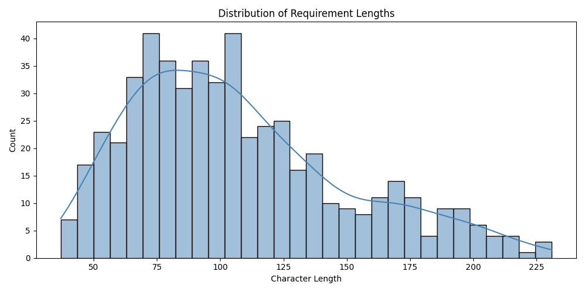
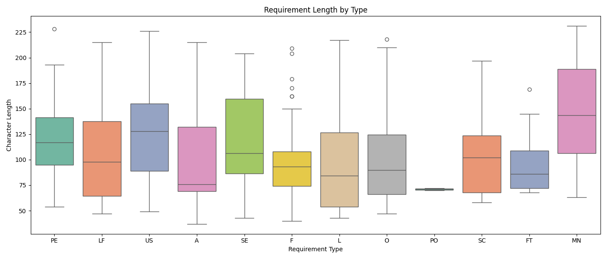
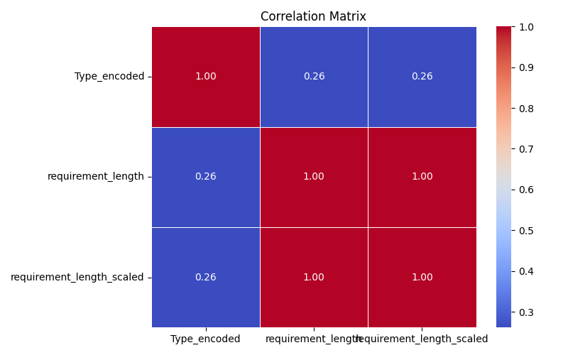
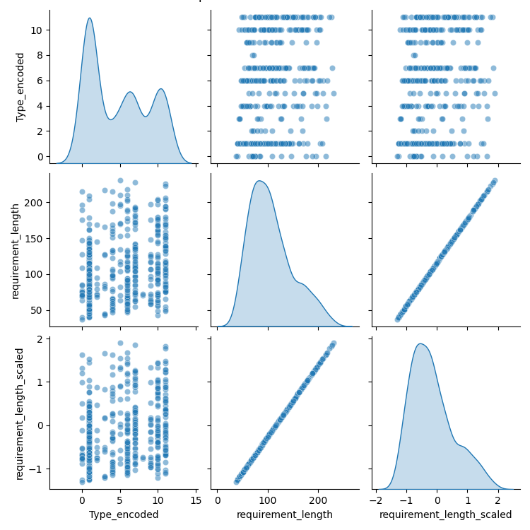

# Task 02 — Exploratory Data Analysis (EDA)
### Elevate Labs AI/ML Internship | Dharshin R ([@iqandeq006-hue](https://github.com/iqandeq006-hue))

---

## Overview

This task performs Exploratory Data Analysis (EDA) on the cleaned dataset produced in Task 01 — the **PROMISE NFR (Non-Functional Requirements) Dataset**. The goal is to understand the data deeply through descriptive statistics, visualizations, and pattern recognition before applying any ML model.

This continues directly from Task 01 and feeds into my ongoing project: an **LLM-based Voice-to-SRS Document Generator**, where understanding the structure and distribution of requirement types is essential for building an accurate classifier.

---

## Dataset

| Property | Detail |
|---|---|
| **Source** | `software_requirements_cleaned.csv` (output of Task 01) |
| **Size** | 527 rows × 5 columns |
| **Columns** | `Type`, `Description`, `Type_encoded`, `requirement_length`, `requirement_length_scaled` |

### Requirement Type Distribution

| Type | Count | Meaning |
|---|---|---|
| `F` | 198 | Functional |
| `US` | 61 | Usability |
| `O` | 55 | Operational |
| `SE` | 54 | Security |
| `PE` | 52 | Performance |
| `LF` | 32 | Look & Feel |
| `A` | 20 | Availability |
| `SC` | 20 | Scalability |
| `MN` | 14 | Maintainability |
| `L` | 10 | Legal |
| `FT` | 9 | Fault Tolerance |
| `PO` | 2 | Portability |

---

## Summary Statistics

| Metric | `Type_encoded` | `requirement_length` | `requirement_length_scaled` |
|---|---|---|---|
| **Count** | 527 | 527 | 527 |
| **Mean** | 4.83 | 106.68 | -0.16 |
| **Std** | 3.89 | 42.39 | 0.70 |
| **Min** | 0 | 37 | -1.31 |
| **25%** | 1 | 75 | -0.69 |
| **Median** | 4 | 98 | -0.30 |
| **75%** | 9 | 130.5 | 0.23 |
| **Max** | 11 | 231 | 1.90 |

---

## Steps Performed

### 1. Library Setup & Dataset Loading
Installed and imported `pandas`, `numpy`, `matplotlib`, `seaborn`, and `plotly`. Loaded `software_requirements_cleaned.csv` directly from Task 01's output.

### 2. Summary Statistics
Generated descriptive statistics using `df.describe()` and computed the value count distribution across all 12 requirement types. Key finding: **Functional (F)** requirements dominate with 198 entries — nearly 3× more than the next category (US: 61), while **Portability (PO)** has only 2 entries.

### 3. Histogram — Requirement Length Distribution
```python
sns.histplot(df['requirement_length'], bins=30, kde=True, color='steelblue')
```
The distribution is **right-skewed** (skewness ≈ +0.8), meaning most requirements are short-to-medium in length, with a long tail of a few very verbose ones. The bulk falls between 50–130 characters.



### 4. Boxplot — Requirement Length by Type
```python
sns.boxplot(data=df, x='Type', y='requirement_length', palette='Set2')
```
Reveals per-type variability. **MN (Maintainability)** and **SE (Security)** tend to have the longest requirements, while **PO (Portability)** and **FT (Fault Tolerance)** are shorter and more tightly distributed. **F (Functional)** has the most outliers due to its large sample size.



### 5. Interactive Bar Chart — Type Distribution (Plotly)
```python
fig = px.bar(type_counts, x='Type', y='Count', color='Type', text='Count')
```
An interactive Plotly chart visually confirms the heavy class imbalance in the dataset, particularly the dominance of Functional requirements.

### 6. Correlation Matrix
```python
corr = df[['Type_encoded', 'requirement_length', 'requirement_length_scaled']].corr()
sns.heatmap(corr, annot=True, cmap='coolwarm')
```
`requirement_length` and `requirement_length_scaled` are perfectly correlated (1.00) — as expected since one is just a scaled version of the other. `Type_encoded` shows a weak positive correlation (0.26) with length, indicating a mild tendency for certain requirement types to be longer.



### 7. Pairplot
```python
sns.pairplot(df[['Type_encoded', 'requirement_length', 'requirement_length_scaled']], diag_kind='kde')
```
The pairplot confirms: `requirement_length` vs `requirement_length_scaled` is a perfect diagonal line (linear transform). The `Type_encoded` distributions show a multi-modal KDE due to the 12 discrete categories. No strong linear relationship exists between type and length.



### 8. Feature-Level Inferences
```
Average Requirement Length per Type (descending):
MN → 149.1  |  SE → 128.4  |  US → 118.5  |  PE → 116.6
LF → 111.0  |  A  → 109.4  |  SC → 107.4  |  O  → 106.7
F  →  96.5  |  L  →  95.0  |  FT →  89.7  |  PO →  69.5

Most common type  → F  (198 requirements)
Least common type → PO (2 requirements)
Skewness of requirement_length → 0.8 (right-skewed)
```

---

## Key Findings

- **Heavy class imbalance**: Functional requirements (F) make up ~37.6% of the dataset. Any classifier trained on this data must account for this imbalance (e.g., via oversampling, class weights, or stratified splits).
- **Right-skewed length distribution**: Most requirements are concise; a few are significantly longer. This matters for LLM tokenization and prompt budgeting.
- **Weak type-length correlation (0.26)**: Requirement type alone doesn't strongly predict its length, suggesting that classification models will need to rely on the text content (Description), not just length features.
- **MN and SE write the most**: Maintainability and Security requirements tend to be the most verbose on average — likely because they require more precise specification.

---

## Visualizations

| File | Description |
|---|---|
| `histogram_requirement_length.png` | Distribution of character lengths across all requirements |
| `boxplot_by_type.png` | Per-type length spread showing medians and outliers |
| `correlation_matrix.png` | Heatmap of correlations between numerical features |
| `pairplot.png` | Pairwise scatter + KDE plots for all numerical features |

---

## Folder Structure

```
elevate-labs-task2/
│
├── data/
│   └── software_requirements_cleaned.csv   # input dataset from Task 01
│
├── notebook/
│   └── Task_02.ipynb                       # full EDA notebook
│
├── images/
│   ├── histogram_requirement_length.png
│   ├── boxplot_by_type.png
│   ├── correlation_matrix.png
│   └── pairplot.png
│
└── README.md
```

---

## Why This Dataset?

This EDA directly informs the design of my **Voice-to-SRS Document Generator** agent:

- The class imbalance analysis tells me I'll need a **balanced training strategy** when fine-tuning or prompting a classifier.
- The length distribution informs **token budget planning** for LLM-based processing.
- The per-type length patterns help set **expectations for generated requirement verbosity** in the final SRS output.

---

## Tools Used

- Python 3
- Google Colab
- Pandas, NumPy
- Matplotlib, Seaborn
- Plotly Express

---

## Internship

**Program:** Elevate Labs — 45 Day AI/ML Internship  
**Task:** 02 — Exploratory Data Analysis (EDA)  
**Submitted by:** Dharshin R | [@iqandeq006-hue](https://github.com/iqandeq006-hue)
